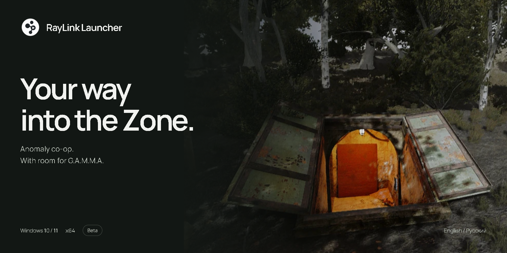
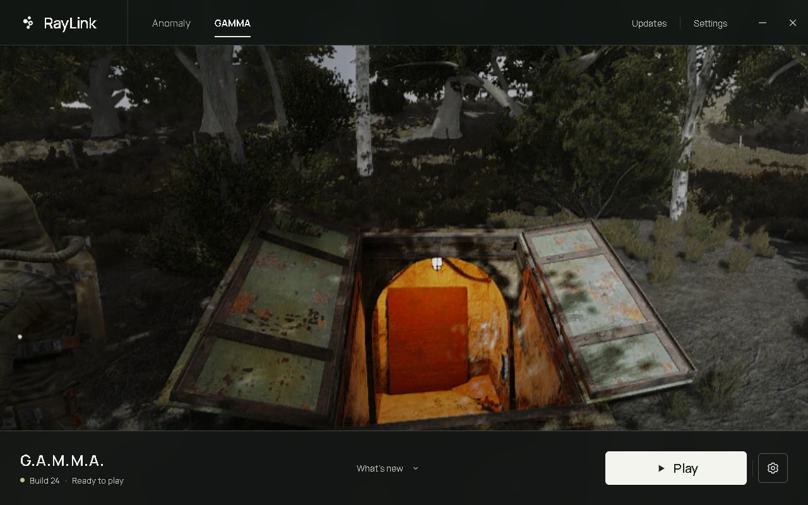

<strong>English</strong> &nbsp; / &nbsp; <a href="README.ru.md">Русский</a>

# RayLink Launcher

A Windows launcher for **RayLink co-op in S.T.A.L.K.E.R. Anomaly**, with optional **G.A.M.M.A.** support. Choose your game folders, download a co-op build and prepare a separate game installation. Then head into the Zone.

**[Download for Windows](https://github.com/stormie-labs/RayLink-Launcher/releases/latest/download/RayLinkSetup.exe)** &nbsp; · &nbsp; [Release notes](https://github.com/stormie-labs/RayLink-Launcher/releases/latest) &nbsp; · &nbsp; [Report a problem](https://github.com/stormie-labs/RayLink-Launcher/issues/new)

Windows 10 / 11 · x64 · English / Русский · Beta

## Your next expedition, in one place

RayLink brings game selection, co-op builds, update progress and launch controls into one desktop app. The installer lets you choose a language and installation folder; the launcher checks for its own updates at startup. Hosting and joining multiplayer sessions happen **inside the game**.

Your original Anomaly installation and GAMMA mods stay untouched. RayLink prepares its own game files and keeps separate saves for Anomaly and GAMMA. Updates and rebuilds preserve your saves and preferences.

## From setup to Play

1. **Install RayLink.** Run [RayLinkSetup.exe](https://github.com/stormie-labs/RayLink-Launcher/releases/latest/download/RayLinkSetup.exe), choose English or Russian, then choose a folder **on the same drive as your games**. This is where RayLink, downloaded builds and cache live.
2. **Choose your game.** Select Anomaly or GAMMA in the launcher. Point it to your existing **Anomaly 1.5.3** folder. For GAMMA, also choose its Mod Organizer folder and profile.
3. **Download a co-op build.** Check **Updates** and install the available build. The launcher shows download and preparation progress.
4. **Prepare and play.** Choose **Prepare game**. When preparation finishes, choose **Play**, then host or join a session from the game.

You need an existing Anomaly installation; GAMMA is optional and must already be installed if you want to use it. RayLink does not include either game installation. Internet access is needed to download builds and updates.

### Keep game files on the same drive

The prepared game folder, Anomaly and enabled GAMMA mods must share a drive for hard links. RayLink links files that are safe to share and copies files that need their own writable version. If the drives differ, the launcher asks you to choose a suitable prepared-game folder in **Settings → Game files** before continuing.

Preparation time depends on your storage, game files and mod profile. RayLink and its co-op builds are **beta software**; compatibility and multiplayer behavior can change between builds. Check the release notes for the build you use.

## Your files stay yours

| What | Where / what happens |
| :--- | :--- |
| Launcher, downloaded builds and cache | Your chosen RayLink installation folder |
| Prepared game files | The RayLink game folder, or the folder selected in Settings |
| Launcher preferences | `%APPDATA%\RayLink\settings.json` |
| Uninstall | Removes the launcher and shortcuts; game files, builds and saves remain |
| “Delete launcher settings” checkbox | Off by default; select it to remove this installation’s launcher preferences too |

Open the uninstaller from **Settings → Uninstall RayLink** or Windows installed apps.

## Help shape the beta

Found a problem? [Open an issue](https://github.com/stormie-labs/RayLink-Launcher/issues/new) with your launcher version, co-op build, game choice and steps to reproduce it. Include the relevant error or a screenshot, and remove personal information from logs before sharing them.

## About RayLink

**RayLink Launcher is proprietary, closed-source software.** This repository's main branch provides product information, downloads and issue tracking. New application versions are distributed as installers; source development is private. See [LICENSE](LICENSE) for terms, [usage terms](TERMS.md) and [THIRD_PARTY_NOTICES.md](THIRD_PARTY_NOTICES.md) for third-party notices.

The launcher is a separate project from the open-source [RayLink Engine](https://github.com/stormie-labs/RayLink-Engine) and [RayLink Co-op](https://github.com/stormie-labs/RayLink-Coop). Their source and licenses remain in their respective repositories.

RayLink is an independent community project, unaffiliated with GSC Game World, the Anomaly team or the G.A.M.M.A. team. Referenced names and marks belong to their respective owners.
