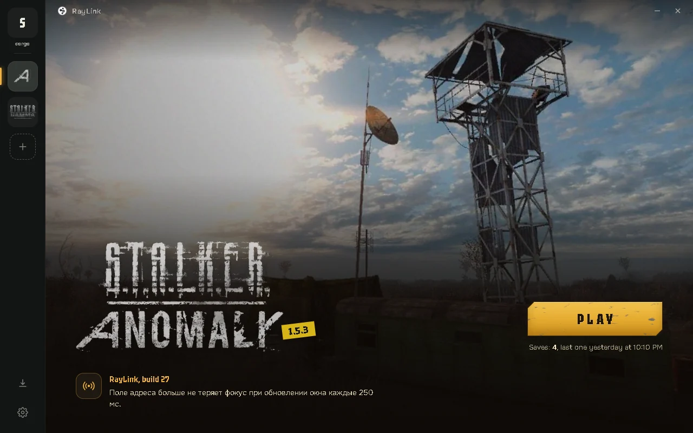
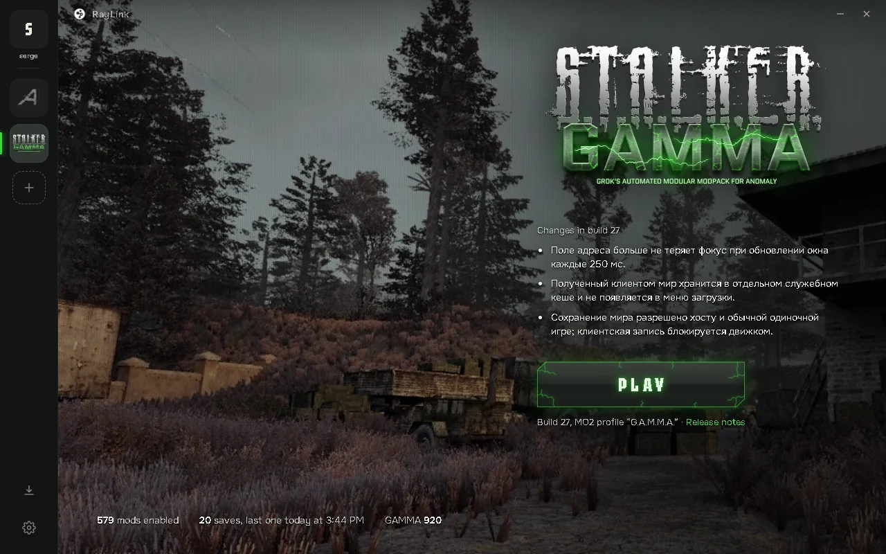
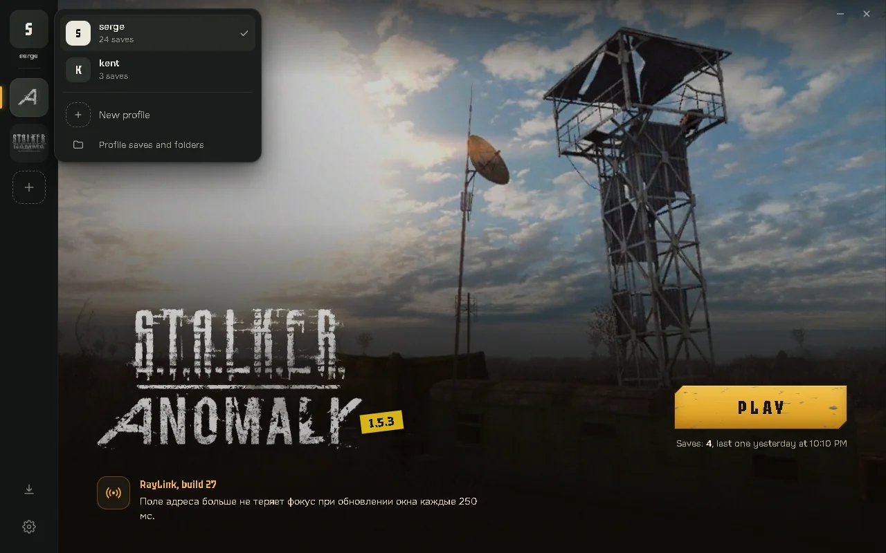
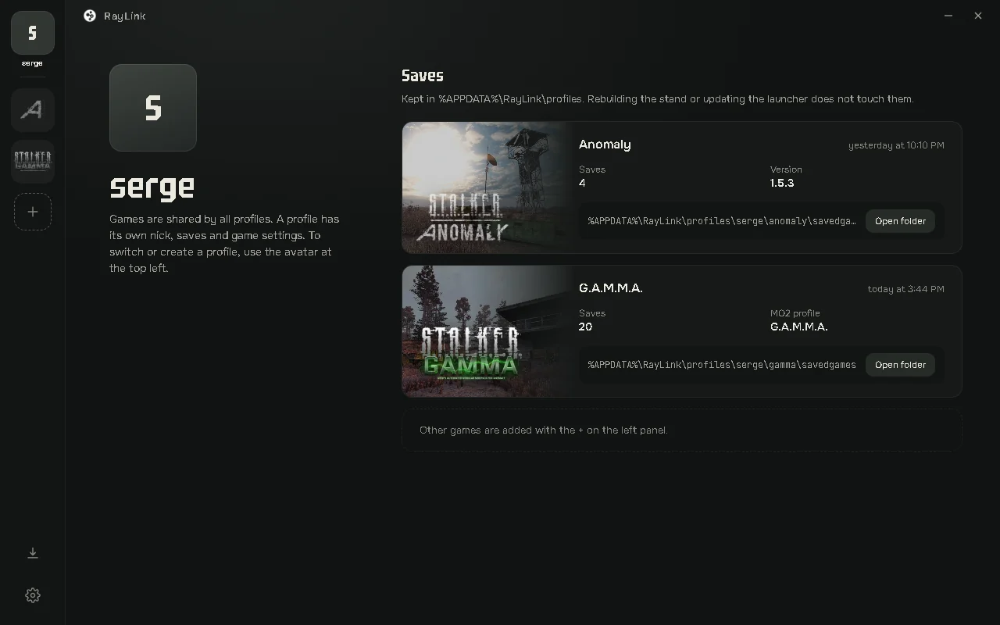
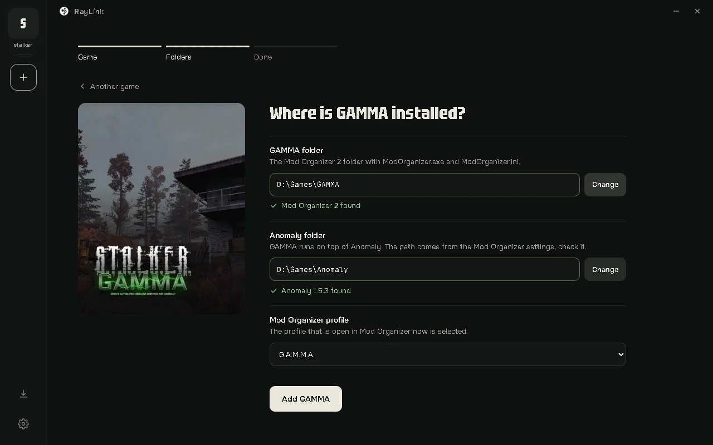
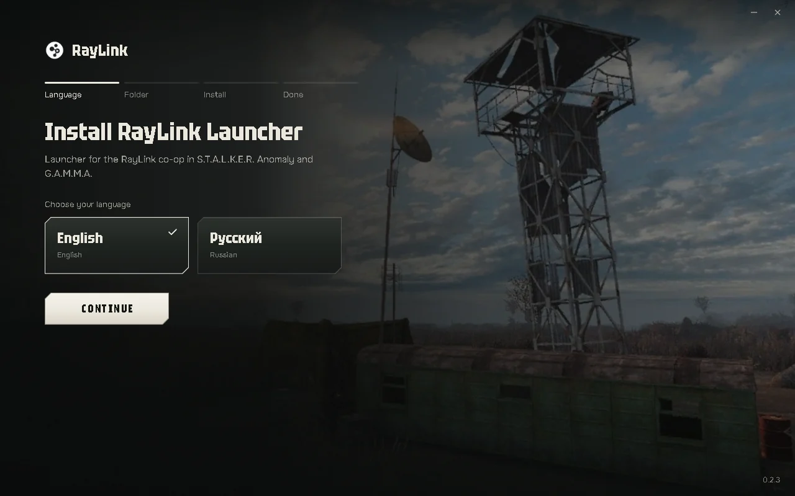

<strong>English</strong> &nbsp; / &nbsp; <a href="README.ru.md">Русский</a>

<h1 align="center">RayLink Launcher</h1>

Co-op launcher for <b>S.T.A.L.K.E.R. Anomaly</b> and <b>G.A.M.M.A.</b> on the RayLink Engine.

  <a href="https://github.com/stormie-labs/RayLink-Launcher/releases/latest/download/RayLinkSetup.exe"><b>Download for Windows</b></a>
  &nbsp;·&nbsp; <a href="https://github.com/stormie-labs/RayLink-Launcher/releases/latest">What's new</a>
  &nbsp;·&nbsp; <a href="https://github.com/stormie-labs/RayLink-Launcher/issues/new">Report a problem</a>

Windows 10 / 11 · x64 · English / Русский · Beta

## A page for every game

<table>
  <tr>
    <td width="50%"></td>
    <td width="50%"></td>
  </tr>
</table>

Anomaly and G.A.M.M.A. each have their own page with the game's logo, a Play button and the changes in the current co-op build. Switch games on the rail on the left. The downloads icon shows the number of a new build as soon as it is out and a progress ring while it downloads.

## One nick, saves of your own

<table>
  <tr>
    <td width="50%"></td>
    <td width="50%"></td>
  </tr>
</table>

A profile is your nick. It is used in every game; saves and game settings are kept per profile. Several players on one PC each get their own. Switch or create a profile from the avatar at the top of the rail.

Saves, `user.ltx` and logs live in `%APPDATA%\RayLink\profiles\<nick>\<game>`. Rebuilding the game files, updating or reinstalling the launcher does not touch them. When you update from an older launcher, the saves it kept in the game folder are copied to your existing nick on the first launch; the originals stay where they were.

## Add a game in three steps

The **+** on the rail opens **Game → Folders → Done**. For G.A.M.M.A. you pick the Mod Organizer 2 folder; the Anomaly folder and the active profile are taken from Mod Organizer and checked right away. Games are shared by all profiles.

## Install

1. **Run [RayLinkSetup.exe](https://github.com/stormie-labs/RayLink-Launcher/releases/latest/download/RayLinkSetup.exe).** Choose a language and a folder **on the same drive as your games**. The launcher, downloaded builds and cache live there.
2. **Add your game.** Press **+** and point the launcher to your **Anomaly 1.5.3** folder; for G.A.M.M.A. to its Mod Organizer folder.
3. **Play.** The first press downloads the co-op build and prepares a separate game folder; after that, Play starts the game. Host or join a session from the game.

You need an existing Anomaly 1.5.3 installation; G.A.M.M.A. is optional and must already be installed. RayLink does not include either game. Internet access is needed for builds and updates.

### Keep game files on the same drive

The prepared game folder, Anomaly and the enabled G.A.M.M.A. mods must share a drive: RayLink hard-links files that are safe to share and copies the ones that need their own writable version. If the drives differ, the launcher asks you to choose another one in **Settings → Stand folder**. Preparation time depends on your storage and mod profile.

## Your files stay yours

| What | Where / what happens |
| :--- | :--- |
| Saves, `user.ltx`, logs | `%APPDATA%\RayLink\profiles\<nick>\<game>` |
| Launcher, downloaded builds, cache | The RayLink folder you chose in the installer |
| Prepared game files | The RayLink game folder, or the one set in Settings |
| Launcher preferences | `%APPDATA%\RayLink\settings.json` |
| Your Anomaly and G.A.M.M.A. installations | Not modified |
| Uninstall | Removes the launcher and shortcuts; saves, game files and builds stay |
| "Also delete launcher settings" | Off by default; removes `settings.json` only, saves stay |

Animations do not depend on the Windows "Animation effects" switch. To tone them down, use **Settings → Reduce motion**.

## Help shape the beta

Found a problem? [Open an issue](https://github.com/stormie-labs/RayLink-Launcher/issues/new) with the launcher version, co-op build, game and the steps to reproduce it. Add the error or a screenshot, and remove personal information from logs before sharing them.

## About RayLink

**RayLink Launcher is proprietary, closed-source software.** This repository provides product information, downloads and issue tracking; development is private. See [LICENSE](LICENSE), the [usage terms](TERMS.md) and [THIRD_PARTY_NOTICES.md](THIRD_PARTY_NOTICES.md).

The launcher is separate from the open-source [RayLink Engine](https://github.com/stormie-labs/RayLink-Engine) and [RayLink Co-op](https://github.com/stormie-labs/RayLink-Coop); their source and licenses are in their repositories.

RayLink is an independent community project, unaffiliated with GSC Game World, the Anomaly team or the G.A.M.M.A. team. Game names, logos and artwork belong to their respective owners.
