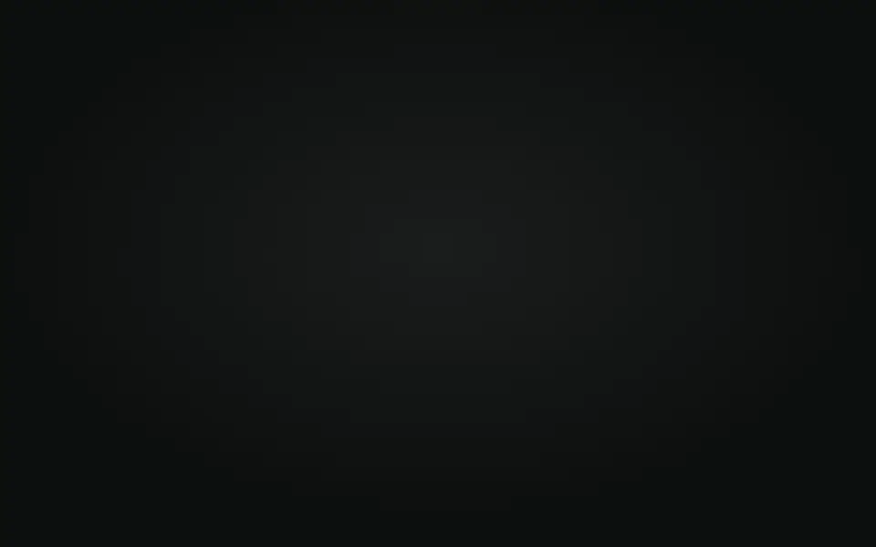
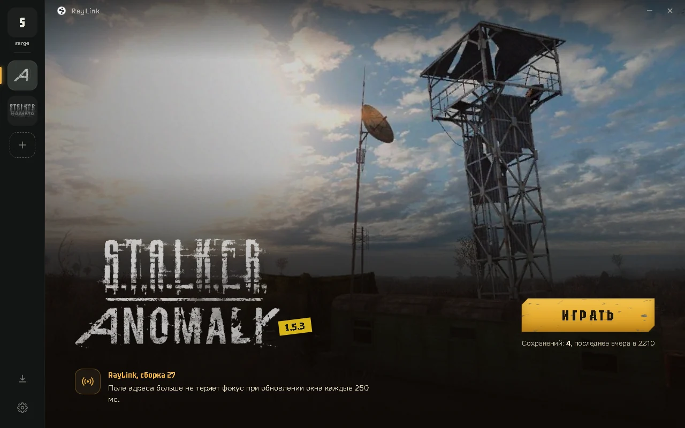
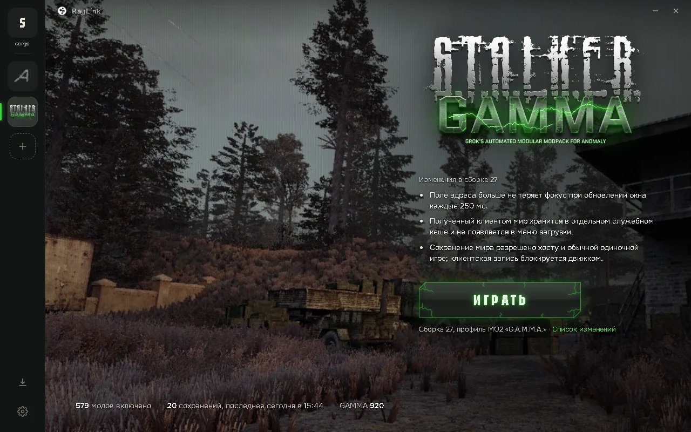
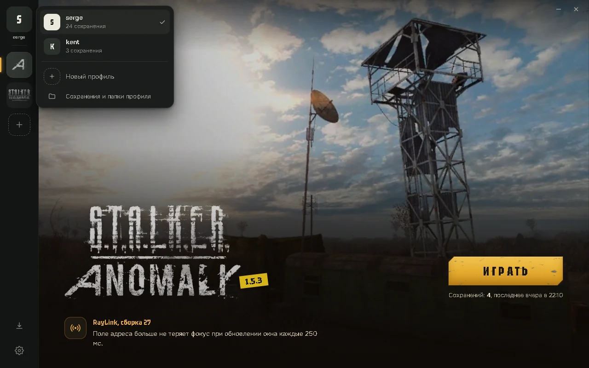
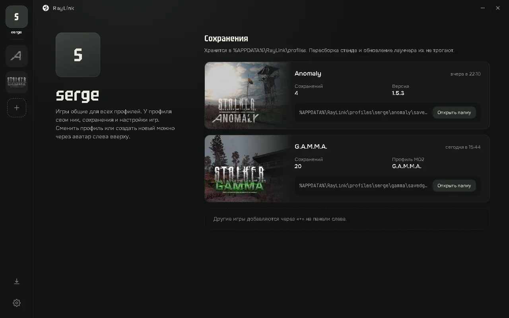
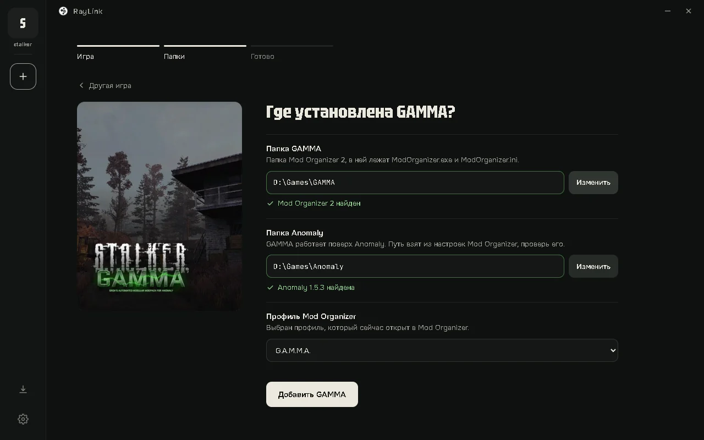
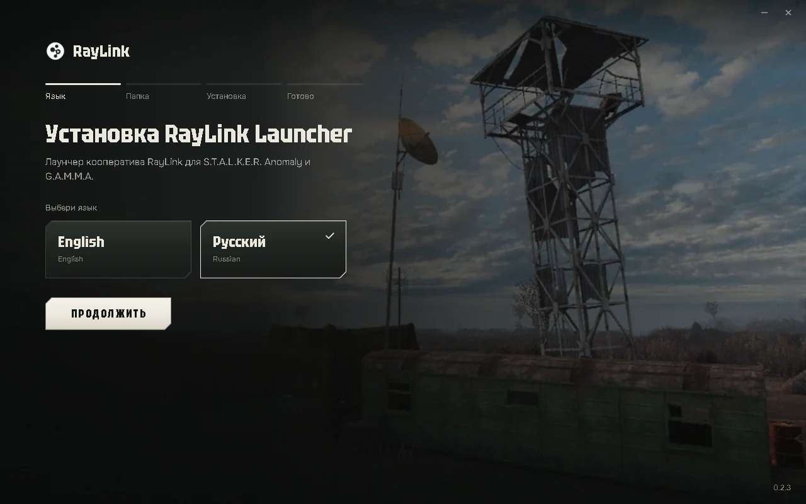

<a href="README.md">English</a> &nbsp; / &nbsp; <strong>Русский</strong>

<h1 align="center">RayLink Launcher</h1>

Лаунчер кооператива для <b>S.T.A.L.K.E.R. Anomaly</b> и <b>G.A.M.M.A.</b> на движке RayLink Engine.

  <a href="https://github.com/stormie-labs/RayLink-Launcher/releases/latest/download/RayLinkSetup.exe"><b>Скачать для Windows</b></a>
  &nbsp;·&nbsp; <a href="https://github.com/stormie-labs/RayLink-Launcher/releases/latest">Что нового</a>
  &nbsp;·&nbsp; <a href="https://github.com/stormie-labs/RayLink-Launcher/issues/new">Сообщить о проблеме</a>

Windows 10 / 11 · x64 · English / Русский · Бета

## Своя страница у каждой игры

<table>
  <tr>
    <td width="50%"></td>
    <td width="50%"></td>
  </tr>
</table>

У Anomaly и G.A.M.M.A. свои страницы: логотип игры, кнопка «Играть» и изменения в текущей сборке кооператива. Игры переключаются на панели слева. Значок загрузок показывает номер новой сборки, как только она выходит, и кольцо прогресса во время загрузки.

## Один ник, свои сохранения

<table>
  <tr>
    <td width="50%"></td>
    <td width="50%"></td>
  </tr>
</table>

Профиль — это ваш ник. Он один во всех играх, а сохранения и настройки игр у каждого профиля свои. Если на одном ПК играют несколько человек, у каждого будет своё. Сменить или создать профиль можно через аватар вверху панели.

Сохранения, `user.ltx` и логи лежат в `%APPDATA%\RayLink\profiles\<ник>\<игра>`. Пересборка файлов игры, обновление и переустановка лаунчера их не трогают. При переходе со старого лаунчера сохранения, которые он хранил в папке игры, при первом запуске копируются вашему нику; оригиналы остаются на месте.

## Игра добавляется в три шага

**+** на панели открывает **Игра → Папки → Готово**. Для G.A.M.M.A. достаточно указать папку Mod Organizer 2: папка Anomaly и открытый профиль берутся из его настроек и сразу проверяются. Игры общие для всех профилей.

## Установка

1. **Запустите [RayLinkSetup.exe](https://github.com/stormie-labs/RayLink-Launcher/releases/latest/download/RayLinkSetup.exe).** Выберите язык и папку **на том же диске, что и игры**. Там будут лаунчер, скачанные сборки и кэш.
2. **Добавьте игру.** Нажмите **+** и укажите папку **Anomaly 1.5.3**, для G.A.M.M.A. — папку Mod Organizer.
3. **Играйте.** Первое нажатие скачивает сборку кооператива и готовит отдельную папку игры, дальше «Играть» сразу запускает игру. Создать сессию или подключиться можно в самой игре.

Нужна установленная Anomaly 1.5.3; G.A.M.M.A. — по желанию, она должна быть уже установлена. Сами игры RayLink не содержит. Для сборок и обновлений нужен интернет.

### Файлы игры — на одном диске

Подготовленная папка игры, Anomaly и включённые моды G.A.M.M.A. должны лежать на одном диске: RayLink делает жёсткие ссылки на файлы, которые можно делить, и копирует те, которым нужна своя записываемая версия. Если диски разные, лаунчер попросит выбрать другую в **Настройки → Папка стенда**. Время подготовки зависит от диска и профиля модов.

## Ваши файлы остаются вашими

| Что | Где / что происходит |
| :--- | :--- |
| Сохранения, `user.ltx`, логи | `%APPDATA%\RayLink\profiles\<ник>\<игра>` |
| Лаунчер, скачанные сборки, кэш | Папка RayLink, выбранная в установщике |
| Подготовленные файлы игры | Папка игры RayLink или та, что задана в настройках |
| Настройки лаунчера | `%APPDATA%\RayLink\settings.json` |
| Ваши установки Anomaly и G.A.M.M.A. | Не изменяются |
| Удаление | Удаляет лаунчер и ярлыки; сохранения, файлы игры и сборки остаются |
| «Удалить и настройки лаунчера» | По умолчанию выключено; удаляет только `settings.json`, сохранения остаются |

Анимации не зависят от переключателя «Эффекты анимации» в Windows. Чтобы их приглушить, включите **Настройки → Уменьшить анимацию**.

## Помогите с бетой

Нашли проблему? [Откройте issue](https://github.com/stormie-labs/RayLink-Launcher/issues/new): версия лаунчера, сборка кооператива, игра и шаги, чтобы повторить. Приложите ошибку или скриншот и уберите из логов личные данные.

## О RayLink

**RayLink Launcher — проприетарная программа с закрытым кодом.** В этом репозитории — описание, загрузки и issue; разработка ведётся закрыто. См. [LICENSE](LICENSE), [условия использования](TERMS.md) и [THIRD_PARTY_NOTICES.md](THIRD_PARTY_NOTICES.md).

Лаунчер — отдельный проект от открытых [RayLink Engine](https://github.com/stormie-labs/RayLink-Engine) и [RayLink Co-op](https://github.com/stormie-labs/RayLink-Coop); их код и лицензии — в их репозиториях.

RayLink — независимый проект сообщества, не связанный с GSC Game World, командой Anomaly и командой G.A.M.M.A. Названия, логотипы и арт игр принадлежат их правообладателям.
