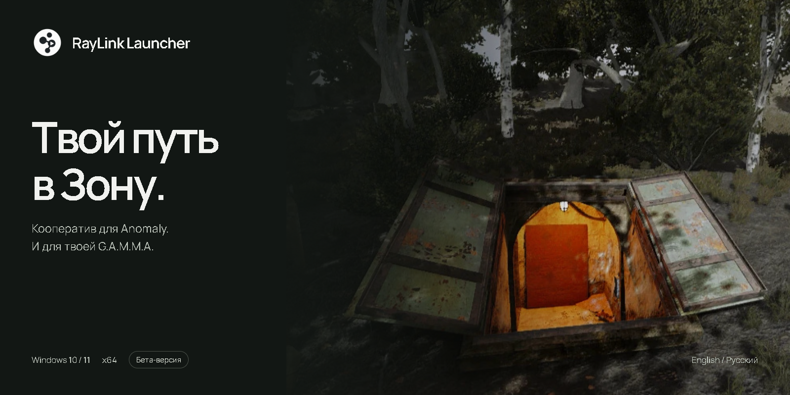
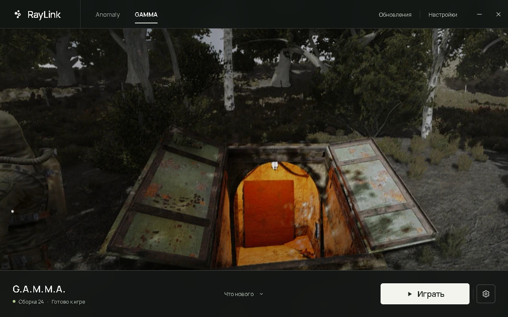

<a href="README.md">English</a> &nbsp; / &nbsp; <strong>Русский</strong>

# RayLink Launcher

Лаунчер для Windows, который готовит **кооператив RayLink для S.T.A.L.K.E.R. Anomaly**, в том числе с **G.A.M.M.A.** Выбери папки игры, скачай кооп-сборку и подготовь отдельную установку. Дальше — в Зону.

**[Скачать для Windows](https://github.com/stormie-labs/RayLink-Launcher/releases/latest/download/RayLinkSetup.exe)** &nbsp; · &nbsp; [Что нового](https://github.com/stormie-labs/RayLink-Launcher/releases/latest) &nbsp; · &nbsp; [Сообщить о проблеме](https://github.com/stormie-labs/RayLink-Launcher/issues/new)

Windows 10 / 11 · x64 · English / Русский · Бета-версия

## Всё для следующей вылазки

Выбор игры, кооп-сборки, ход обновления и запуск — в одном приложении. В установщике можно выбрать язык и папку; при запуске лаунчер проверяет собственные обновления. Создание сетевой сессии и подключение к ней происходят **внутри игры**.

Исходная Anomaly и моды GAMMA остаются нетронутыми. RayLink готовит отдельные игровые файлы и хранит раздельные сохранения для Anomaly и GAMMA. Обновления и пересборка сохраняют твои сейвы и настройки.

## От установки до кнопки «Играть»

1. **Установи RayLink.** Запусти [RayLinkSetup.exe](https://github.com/stormie-labs/RayLink-Launcher/releases/latest/download/RayLinkSetup.exe), выбери английский или русский язык, затем папку **на том же диске, что и игры**. Здесь будут храниться RayLink, загруженные сборки и кэш.
2. **Выбери игру.** Переключись на Anomaly или GAMMA в лаунчере. Укажи папку установленной **Anomaly 1.5.3**. Для GAMMA также выбери папку Mod Organizer и профиль.
3. **Скачай кооп-сборку.** Открой **«Обновления»** и установи доступную сборку. Лаунчер покажет ход загрузки и подготовки.
4. **Подготовь и запускай.** Нажми **«Подготовить игру»**. После завершения станет доступна кнопка **«Играть»**. Создать сессию или подключиться к другу можно уже в игре.

Понадобится установленная Anomaly. GAMMA необязательна, но для игры с ней она тоже должна быть установлена заранее. RayLink не включает эти игровые установки. Для загрузки сборок и обновлений нужен интернет.

### Игровые файлы — на одном диске

Для жёстких ссылок папка подготовленной игры, Anomaly и включённые моды GAMMA должны находиться на одном диске. RayLink связывает файлы, которые безопасно использовать совместно, и копирует те, которым нужна собственная изменяемая версия. Если диски различаются, лаунчер предложит выбрать подходящую папку через **«Настройки → Файлы игры»**, прежде чем продолжить.

Время подготовки зависит от накопителя, игровых файлов и профиля модов. Лаунчер и кооп-сборки находятся **в бета-тестировании**: совместимость и поведение сетевой игры могут меняться. Перед обновлением читай примечания к выбранной сборке.

## Твои файлы остаются с тобой

| Что | Где хранится / что происходит |
| :--- | :--- |
| Лаунчер, загруженные сборки и кэш | В выбранной папке установки RayLink |
| Подготовленные игровые файлы | В игровой папке RayLink или в папке из настроек |
| Настройки лаунчера | `%APPDATA%\RayLink\settings.json` |
| Удаление приложения | Удаляются лаунчер и ярлыки; игровые файлы, сборки и сейвы остаются |
| Галка «Удалить настройки лаунчера» | По умолчанию выключена; включи её, чтобы удалить и настройки этой установки |

Деинсталлятор открывается через **«Настройки → Удалить RayLink»** или список установленных приложений Windows.

## Помоги улучшить бету

Нашёл проблему? [Создай issue](https://github.com/stormie-labs/RayLink-Launcher/issues/new): укажи версию лаунчера, кооп-сборку, выбранную игру и шаги воспроизведения. Приложи текст ошибки или скриншот. Перед отправкой логов убери личные данные.

## О проекте

**RayLink Launcher — проприетарное приложение с закрытым исходным кодом.** Основная ветка этого репозитория содержит описание продукта, загрузки и обсуждение проблем. Новые версии публикуются установщиками; разработка исходников ведётся приватно. Условия — в [LICENSE](LICENSE) и [TERMS.md](TERMS.md), сведения о сторонних компонентах — в [THIRD_PARTY_NOTICES.md](THIRD_PARTY_NOTICES.md).

Лаунчер — отдельный проект. [RayLink Engine](https://github.com/stormie-labs/RayLink-Engine) и [RayLink Co-op](https://github.com/stormie-labs/RayLink-Coop) остаются открытыми: их код и лицензии доступны в собственных репозиториях.

RayLink — независимый проект сообщества, не связанный с GSC Game World, командой Anomaly или командой G.A.M.M.A. Упомянутые названия и знаки принадлежат их владельцам.
